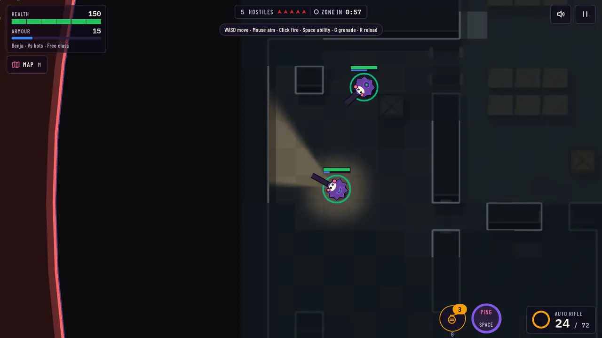
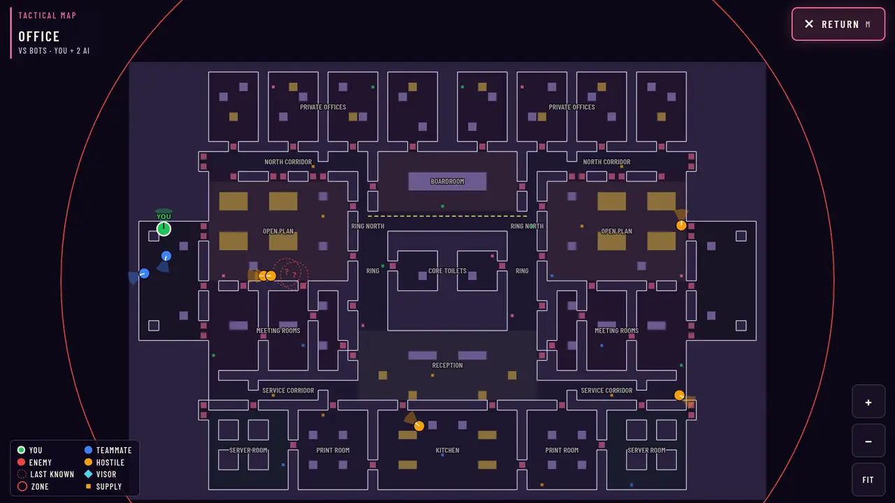
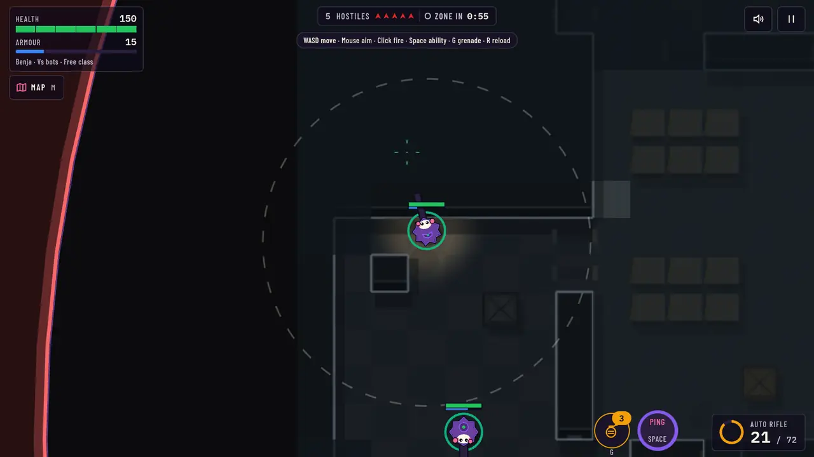
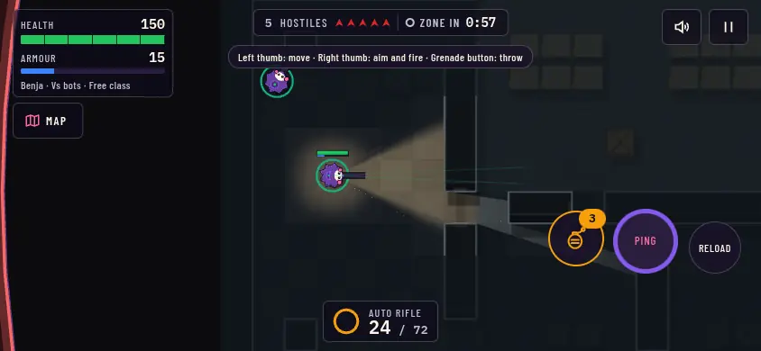
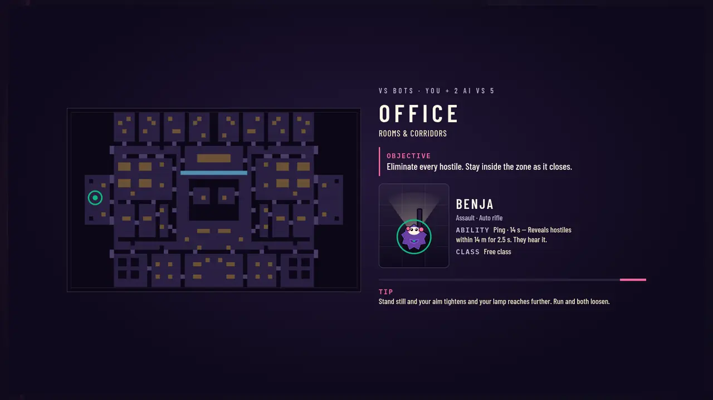
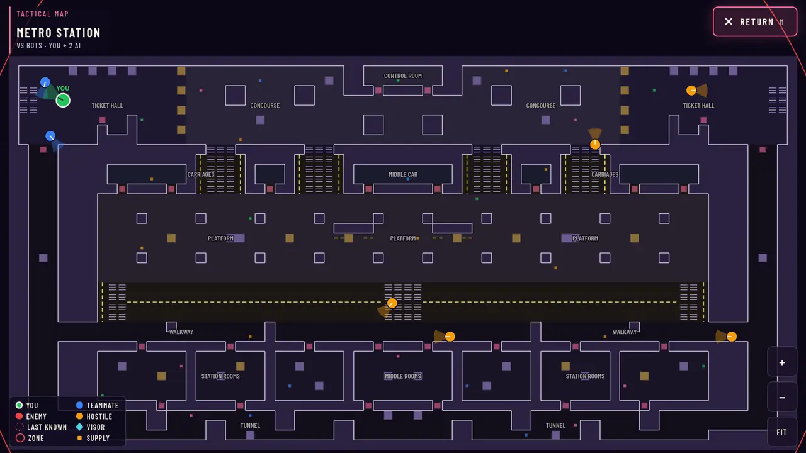
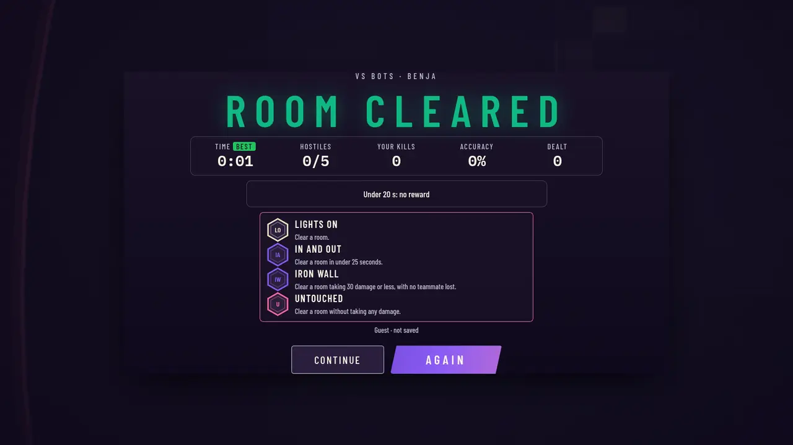

<div align="center">

# CHOG: ROOM ZERO

**A dark top-down tactical shooter where information is the resource.**

You only see what your light touches. Everyone hears everything. Rooms last about 90 seconds.

[**Play now**](https://chogroomzero.xyz) · [In-game Library](https://chogroomzero.xyz/library) · [Multiplayer design](docs/MULTIPLAYER.md) · [Superpowers](docs/design/superpowers.md) · [Developer guide](docs/DEV.md)


[](https://chogroomzero.xyz)



<sub>A solo match on Office, desktop. Captured from the game's own Library screenshots.</sub>

</div>

---

Chog: Room Zero is a browser game for desktop (keyboard and mouse) and phones or tablets in landscape (twin-stick touch). It was built for the Chogathon, around the Chog Genesis NFT collection on Monad.

Most top-down shooters show you the whole arena. Room Zero doesn't. Walls block both bullets and vision, footsteps carry farther than your light does, and the tactical map shows you what your squad knows. Winning comes down to what you hear, where you look and when you make noise.

> [!NOTE]
> **No wallet or account is needed to play.** Solo, 1v1 and 3v3 are open to everyone as a guest. Signing in (Google or a wallet) only saves progression to an account. A Chog NFT gives a trait-based superpower, and 5v5 is for verified holders.

## Contents

- [Gameplay](#gameplay)
- [Modes](#modes)
- [Controls](#controls)
- [Chog Genesis integration](#chog-genesis-integration)
- [Screenshots](#screenshots)
- [How it works](#how-it-works)
- [Run it locally](#run-it-locally)
- [Configuration](#configuration)
- [Testing](#testing)
- [Deployment](#deployment)
- [Project structure](#project-structure)
- [Status and known limits](#status-and-known-limits)
- [How this repo is worked on](#how-this-repo-is-worked-on)
- [License](#license)

## Gameplay

| Mechanic | What it means in a match |
|---|---|
| **Bullets travel** | No hitscan. Every shot is a projectile you can see, and walls, crates and cover stop it. |
| **Real occlusion** | Your vision is cut by wall geometry. Anything outside your light cone is dark. |
| **Sound is information** | Running is loud and creeping is quiet. Floor surfaces change how far steps carry. Noises you hear but can't see show up as rings. Bots hear you by the same rules. |
| **Tactical map** (`M`) | The full floor plan with area names, the danger zone, supplies, your squad and the live position of every hostile. |
| **Bots that play tactically** | They patrol, investigate sounds, pursue, use cover, hold angles, reposition and break line of sight instead of rushing you. |
| **Danger zone** | After the opening, a red zone closes in warned stages. Outside it you lose health, and faster each stage. |
| **Squads and revives** | Solo play is you plus two AI teammates against bots. A downed teammate can be revived. |
| **Grenades for everyone** | Everyone carries grenades (`G`). Pickups (health, armour, ammo) are taken on contact and come back 4 s after being picked up. |
| **Deliberate movement** | Acceleration, turning and stopping are tuned, not instant. Human aim turns at a capped rate too. |

You win a room by downing every hostile. Online, the last side standing wins.

**Locations (5):** Room Zero, Office, Supermarket, Metro Station, Construction Site. Each has its own layout, tiles and lighting.

**Free roster (7 operators)**, each with one weapon and one ability:

| Operator | Role | Weapon |
|---|---|---|
| Benja | Assault | Rifle |
| Toad | Tank | LMG |
| Ray | Sniper | Marksman rifle |
| Tabsu | Flanker | SMG |
| Tonashiro | Bruiser | Shotgun |
| Yot | Assault | Carbine |
| Bill | Flanker | Sawn-off |

Every operator starts at 150 health. They differ in armour, speed, weapon and ability. Definitions are in [`src/config/heroes.ts`](src/config/heroes.ts).

**Progression** is tied to a signed-in account: XP, levels, shards, upgrades, medals and a rating from validated online matches. Capped solo practice runs also pay shards (with no rating). Guests can play everything except 5v5, but nothing is saved for them.

## Modes

| Mode | Who can play | Where it runs |
|---|---|---|
| **Solo** (you + 2 AI vs bots) | Everyone | In your browser |
| **1v1** | Everyone | Authoritative game server |
| **3v3** | Everyone | Authoritative game server |
| **5v5** | Verified Chog holders only (every squad member), checked by the server | Authoritative game server |
| **Demo / Training** | Everyone. Clearly labelled, with no rewards. | In your browser |

Online matches use squads with a short join code. Matchmaking queues by location, and after a wait it falls back to any location. See [`docs/MULTIPLAYER.md`](docs/MULTIPLAYER.md).

## Controls

PC keys can be rebound in **Settings → Controls**.

| Action | PC (default) | Phone / tablet (landscape) |
|---|---|---|
| Move | `W` `A` `S` `D` | Left thumb (a half push creeps) |
| Creep (quiet walk) | Hold `Shift` | Half push on the left stick |
| Aim | Mouse | Right thumb |
| Fire | Hold left click | Push the right thumb past the ring |
| Ability | `Space` or `Q` | Ability button |
| Grenade | `G` or right click | Grenade button |
| Reload | `R` | Reload button |
| Tactical map | `M` | Map button |
| Pause | `Esc` or `P` | Pause button, top right |

On touch devices the game always plays in landscape. If you hold the phone upright, the stage is drawn turned 90°, so rotate the phone. Turning it mid-run pauses the run without losing anything.

## Chog Genesis integration

Room Zero reads the real **Chog Genesis** collection (ERC-721 on Monad, chain 143, 1,969 tokens, contract `0xc96d31F8626c6D03Fae5dCD3d61e3FB9F4a73763`). The catalogue of traits, rarity and metadata is in [`data/chog-genesis/`](data/chog-genesis/), with research notes in [`docs/research/chog-genesis/`](docs/research/chog-genesis/).

- **Ownership is checked on the server, never in the browser.** You sign in with a wallet (Sign-In with Ethereum), and the site reads Monad live over public RPCs. Any failure falls back to a free profile.
- **A verified Chog's real traits give one superpower** in the ability slot, ranked by tier:

  | Superpower | Comes from the trait |
  |---|---|
  | Laser Eyes | Laser Eyes, or the Blue Laser head |
  | Visor | Visor Eyes |
  | Bubble | Bubblegum mouth |
  | Drool Web | Drooling mouth |
  | Aura | Any Aura |

  X-Ray Eyes has no collection trait. It exists only in Demo and Training.
- **No rarity stat inflation.** No tier adds health, armour or damage. A verified Chog with no mapped power starts at 200 health, and that is its only edge. Details: [`docs/design/superpowers.md`](docs/design/superpowers.md).
- **Account progression is separate from the token.** Transferring a Chog moves no XP or currency. Nothing is sold, and there is no custom contract and no $CHOG dependency.

> [!IMPORTANT]
> The operators are original CHOG-inspired chibis drawn in code (`src/ui/chogShape.ts`), not official collection artwork. The colour palette is a proposal ([`docs/BRAND.md`](docs/BRAND.md)). Rights to Chog Genesis art and names have not been confirmed yet.

## Screenshots

All images below come from the repo (`library/public/library/shots/`). They are the same shots the in-game Library uses.

<table>
  <tr>
    <td width="50%"><br><sub><b>Tactical map:</b> the Office floor plan with area names, your squad and every living hostile at its live position.</sub></td>
    <td width="50%"><br><sub><b>Sound rings:</b> the dashed ring shows how far running and firing carry.</sub></td>
  </tr>
  <tr>
    <td width="50%"><br><sub><b>Touch HUD</b> in phone landscape: the left half moves, the right half aims and fires.</sub></td>
    <td width="50%"><br><sub><b>Deploy briefing:</b> location, map, squad and ability, shown while the room loads.</sub></td>
  </tr>
  <tr>
    <td width="50%"><br><sub><b>Metro Station</b>, one of the five locations.</sub></td>
    <td width="50%"><br><sub><b>ROOM CLEARED:</b> results with the medals earned.</sub></td>
  </tr>
</table>

## How it works

```text
Browser (Vite + PixiJS, desktop or touch)
   │  solo: runs the deterministic sim locally (src/sim)
   │
   ├── online: controls only ──►  Game server (Node + ws, server/)
   │                              same sim at a fixed 60 Hz step, decides movement,
   │◄── filtered snapshots ────   hits, damage, zone and the winner
   │
   └── HTTPS ──►  Vercel Functions (api/)
                    ├── sign-in: Google OAuth (PKCE) or SIWE wallet signature
                    ├── accounts, rewards, leaderboard ──► Neon Postgres (schema room_zero)
                    └── Chog ownership ──► Monad RPC (read-only eth_call)
```

- **One simulation, two hosts.** `src/sim` is pure TypeScript with no DOM, no renderer and no clock. The browser runs it for solo play. The game server runs the same code for online matches, so the server decides everything: movement, firing, bullet travel, hits, damage, pickups, abilities, the zone and the result.
- **Fair information online.** A player's snapshot only includes an enemy their team can actually see or hear, so a modified client can't simply draw hidden players. One known exception is listed under [known limits](#status-and-known-limits).
- **Client prediction** (`src/net/predict.ts`) keeps your own movement responsive between server snapshots.
- **Tickets, not trust.** For holder features, the site signs a short-lived, single-use ticket that the game server checks before it applies a Chog's power.
- **Sound is synthesized in code** with WebAudio (`src/audio/audio.ts`). The repo has no audio files.

**Tech stack:** TypeScript · Vite 8 · PixiJS v8 · Vitest · `ws` · Vercel Functions · Neon Postgres (`@neondatabase/serverless`) · `@noble/curves` and `@noble/hashes` (signature checks) · PGlite (in-memory Postgres for tests) · Barlow Condensed and IBM Plex Mono fonts (OFL, in `public/fonts`).

## Run it locally

You need Node `^22.12.0 || ^24.0.0 || >=26.0.0` and npm.

```bash
git clone https://github.com/levithefirst/chog-room-zero.git
cd chog-room-zero
git checkout ccr-e7fadb8f-qtochk   # the branch production is deployed from (see Status)
npm ci
npm run dev                        # http://localhost:5173
```

Solo play works with no backend at all. A plain `vite` dev server has no `/api`, so sign-in and progression show as unavailable there.

| Command | What it does |
|---|---|
| `npm run dev` | Vite dev server on http://localhost:5173 |
| `npm run typecheck` | `tsc --noEmit` |
| `npm test` | Vitest: unit, simulation, API and server tests |
| `npm run build` | Typecheck, then build the game and the Library into `dist/` |
| `npm run build:library` | Build only the Library (`/library`) |
| `npm run preview` | Serve `dist/` on http://localhost:4173 |
| `npm run build:server` | Bundle the game server into `dist-server/` |
| `npm run server` | Start the game server (`PORT`, default 8787) |

**Play online locally:**

```bash
npm run build:server
PORT=8787 npm run server
# then open the dev client with ?server=ws://127.0.0.1:8787/ws
# or build the client with VITE_GAME_SERVER_URL set
```

To test on a phone, run `npm run dev -- --host` and open the `Network:` URL from a phone on the same Wi-Fi. Browser QA scripts (headless Chrome journeys, cross-device matrix, online runs) are in `tools/` and documented in [`docs/DEV.md`](docs/DEV.md).

## Configuration

All variables are optional for local solo play. Never commit values: `.env*` is git-ignored.

**Vercel Functions (`api/`)**

| Variable | Purpose |
|---|---|
| `AUTH_SECRET` | Signs session cookies and derives the game and practice ticket keys. Must be 32+ characters. Without it, sign-in reports "not set up". |
| `AUTH_ORIGIN` | Canonical site origin, used for the Google redirect URI and the wallet host check |
| `GOOGLE_CLIENT_ID` / `GOOGLE_CLIENT_SECRET` | Google OAuth web client (the secret stays server-side) |
| `AUTH_ALLOWED_HOSTS` | Optional comma-separated list of extra hosts allowed for wallet sign-in |
| `DATABASE_URL` | Neon Postgres connection string. Without it the game runs with "progression offline". |
| `NFT_COMBAT` | Set to `0` to switch Chog superpowers off (on by default) |
| `VITE_GAME_SERVER_URL` | Game server WebSocket URL. The client build reads it to find the server. |

**Game server (`server/`)**

| Variable | Purpose |
|---|---|
| `PORT` | Listen port (default `8787`) |
| `ALLOWED_ORIGINS` | Comma-separated browser origins allowed to open a game socket (exact match) |
| `TICKET_CHECK_URL` | Where the server verifies site-signed tickets (defaults to the production `/api/game/ticket-check`) |
| `FRIENDLY_FIRE` | `1` turns friendly fire on |

Sign-in setup step by step: [`docs/AUTH.md`](docs/AUTH.md). Database schema and migrations: [`docs/DATABASE.md`](docs/DATABASE.md).

## Testing

```bash
env -u DATABASE_URL npm test
```

The suite has 110 Vitest files covering the sim (combat, vision, perception, bots, zone, pickups), the network protocol and server rooms, snapshot privacy, the API and database (against in-memory PGlite), sign-in, the economy, maps and the Library. Unsetting `DATABASE_URL` keeps tests off any real database. On a busy machine a few PGlite-backed files can hit the 10 s hook timeout in a full run; they pass when run on their own (`npx vitest run tests/rewards.test.ts`).

> [!NOTE]
> Automated tests and scripted browser runs cannot judge game feel. Human playtests on real phones are tracked separately in [`docs/GATES.md`](docs/GATES.md) and have not all been done yet (see below).

## Deployment

| Piece | Host | Notes |
|---|---|---|
| Web client + `api/` | Vercel project `chog-room-zero` | https://chogroomzero.xyz |
| Game server | Render free web service, Frankfurt ([`render.yaml`](render.yaml)) | https://room-zero-game.onrender.com. `GET /` is the health check and `/stats` reports load and commit. |
| Database | Neon Postgres | Additive migrations in schema `room_zero`, created on first `/api/game/*` request |

The free Render instance sleeps when idle, so the first online match after a quiet period can take around 20–30 s to connect.

## Project structure

```text
src/
  sim/        deterministic simulation: world, match, bots, vision, intel, zone, pickups
  render/     PixiJS renderer: visibility, light mesh, camera, map bake
  input/      keyboard, mouse, touch, rebindable bindings
  net/        protocol, WebSocket client, prediction, account API
  nft/        Chog trait, tier and power tables, identity, token history
  config/     tuning, weapons, heroes, maps, superpowers, progression
  ui/         hub, HUD, tactical map, medals, profile, sign-in
  audio/      WebAudio synthesis
  library/    the in-game Library at /library
server/       authoritative game server (lobby, rooms)
api/          Vercel Functions: auth, game API, chain checks
data/         Chog Genesis catalogue and metadata
docs/         design docs, rules, state, handoffs
tests/        Vitest suites
tools/        browser QA and data tools
```

## Status and known limits

The live site and game server both run the head of branch `ccr-e7fadb8f-qtochk` (open [PR #10](https://github.com/levithefirst/chog-room-zero/pull/10)). The repo's default branch, `setup/skill-system`, holds only the agent rules and early design docs, with no game code.

**Verified by automated tests and scripted browser runs.** Not yet done:

- Human playtests on all five locations, and on real phones (Pixel 7, iPhone 13)
- Real-GPU frame rates, and checking the audio by ear
- A hosted 5v5 match with a real holder wallet (only tested against a fake chain locally)
- Confirmation of Chog Genesis art and name rights

Known trade-off: the tactical map's live hostile positions are sent to clients online, so a modified client could read them (recorded in [`docs/STATE.md`](docs/STATE.md), H44).

Ongoing state, decisions and open questions: [`docs/STATE.md`](docs/STATE.md).

## How this repo is worked on

Room Zero is built by AI coding agents (Claude Code and Grok Bot) working under the owner's direction. Agents follow [`docs/RULES.md`](docs/RULES.md), record shared state in [`docs/STATE.md`](docs/STATE.md), and append to [`docs/HANDOFFS.md`](docs/HANDOFFS.md) before stopping. Each piece of work has a task card and its own branch, and nothing merges without the owner's approval. [`GROKBOT.md`](GROKBOT.md) and [`CLAUDE.md`](CLAUDE.md) are the per-agent entry points.

Bullet Echo was used as a benchmark only. What was built, adapted or left out is recorded in [`docs/REFERENCE-MAP.md`](docs/REFERENCE-MAP.md).

## License

No license is specified for this repository's code. The bundled fonts are under the SIL Open Font License ([`public/fonts/`](public/fonts/)).
